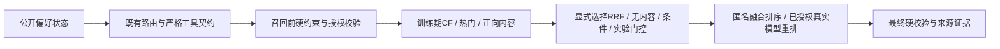

# 深度技术升级验收（2026-10-11）

**完成范围：预登记的一条融合研究、强基线三seed、控制/消融/失败分析及可选推理接入。学习门控和GCN相对强BPR均为 NO VERIFIED GAIN。** 原论文T04阻塞不变，不声称整个项目或论文复现全部完成。

## 问题、方法与结论

旧no_content同时改变召回和匿名排序，是组合消融。固定旧ranker移除内容、固定旧recall移除genre负惩罚后，单独负惩罚修复没有稳定收益。匹配RRF无内容控制另作后补诊断；新内容源有互补，但受到排序目标和数据域影响。100/路、200并集不变；实际CF前10丢失为0，不能将收益归因为候选保护。

实现9个公开特征的logistic门控、标准化、四个正则×三seed、固定权重、条件规则、等权RRF、无内容强对照。门控训练标签105正/673负；三个seed开发审计全部291次禁用内容，外部153次中只有3次启用，但最终指标仍与无内容相同。类别不平衡与收益标签/阈值是可能解释，未被单独因果消融证实。去源质量与去保护无差异，保留负结果，不宣传每个组件有效。

## 真实指标及统计范围

外部结构化实验：旧无内容 NDCG@10 0.151001 → RRF 0.210644，观测相对差异 39.50%；Hit@10 39.87% → 53.59%。用户配对差值95%区间 [0.011644104460701129, 0.11266971147446116]。

只有51个相关暖用户，694无相关用户另计；三个状态先在用户内平均。外部数据/协议及方法先冻结，未读external valid调参；不保证两个MovieLens发布的真实人群完全独立。开发审计RRF对旧无内容的差值区间跨0。以上是多个次要对照的未多重校正区间，不能写跨域稳定提升、线上喜欢概率、CTR或真实LLM任务提升。主学习门控差值0。

固定模型三seed：BPR test NDCG 0.228919±0.003741，GCN 0.227695±0.000859；GCN−BPR用户区间跨0。valid分别0.145874/0.147595。test为 Previously Exposed Test，不能按结果改选模。参数282304/564608，维度32/64；训练/推理时长不是隔离速度比较。新四训练109实际epoch，六权重验证重载valid完全一致，原数据/图/采样数学不改。

旧Agent真LLM结果不重跑、不重写：O/A同接口Strict Success均81.33%，请求190→99。模板聚类补审计实际69组，O−无内容仍负；F/U1解析混杂、replan0的边界保留。不把新组件分数归因到LLM策略。

## 技术结构与发布边界



FusionPipeline兼容既有Agent依赖注入和多轮反馈。工厂接口修复先有失败回归，未改变已评测排序。新增validated profile严格匹配公开记录、checkpoint/训练ID/源码SHA及Python/PyArrow/Torch；padding0与未授权历史被拒绝。候选全链路诊断只写ignored artifacts，拒绝覆盖/越界。原CLI默认模型与排序保持原样，学习门控不自动上线。

## 验证、失败与成本

完整292/292；新独立锁环境35/35，16依赖包离线安装，pip check通过，真实GCN推理及诊断与原环境完全一致；匿名BPR推理也通过。42024项融合原始预测指标与8610条模型用户预测重算，共50634项记录检查；480份历史证据SHA不变。报告重复重建字节一致。

初轮完整281通过/1失败（U1约97秒），单独bridge14.26秒成功，最终完整292通过；90秒超时边界未放宽，根因NOT VERIFIED，日志全保留。数据首版空相关计数、模型报告相对路径错误均先复现再修，首版/失败产物不覆盖。集成测试夹具最初episode命名不合法后修正；CLI辅助演示误用未定义包入口、初次uv默认用户缓存无权限的失败也保留，改用既定cli入口和项目缓存。

新增真实LLM请求0、权重下载0；仅官方100K ZIP 4,924,029bytes和README。正式融合开发203.57秒、外部9.69秒，均本机组件批次时间，不是在线延迟。Windows/CPU、Python3.11.14、Torch2.0.1+cpu、PyArrow21.0.0；GPU/Linux、非editable安装、新完整checkout重训本轮NOT VERIFIED。原T20干净源码重建训练证据保留。

## 贡献、近期研究与剩余优先项

微软上游提供推荐工具/规划/记忆/反思；本轮新增贡献是候选诊断、公开可靠性特征和学习门控、目标一致融合、控制实验、三seed验证、外部冻结协议、用户/模板聚类和可重算证据。RRF与logistic方法已有先例，不称算法首创。

TAIRA、TorchEasyRec、OpenOneRec、OneSearch及HSTU等一手核查见research_landscape_2026.md；借鉴源可靠性、训练服务一致、指令遵循/任务质量分离。没有本机复现其工业模型，也没有SOTA横比。P3条件审查决定本轮不继续SASRec/RL/多Agent/大型权重：稀疏目标、小外部样本和CPU预算无法支持合理比较，不为技术名称扩项目。

下一优先项：先登记更大且尚未暴露的跨域评价与负反馈任务，才能验证RRF泛化或重新设计门控收益标签/校准。不得继续对本次external test调参。暖用户模型目前仍是静态训练画像，没有证明学习到会话兴趣；原ID/矩阵许可问题继续BLOCKED。

## 可执行复现入口

沿用AgenticRec/docs/REPRODUCE.md的锁环境、官方数据重建及U1准备；先将官方100K ZIP与README保存在data/raw/ml-100k-upgrade。以下数据冻结命令仅用于私密目录尚不存在的全新checkout；已有冻结目录拒绝覆盖。正式实验要求源码提交且新目录；旧run拒绝覆盖。

```powershell
& AgenticRec/.venv-t20/Scripts/python.exe -m agenticrec.research_protocol development --output data/eval_private/fusion-development-20261011
& AgenticRec/.venv-t20/Scripts/python.exe -m agenticrec.research_protocol external --output data/eval_private/fusion-external-100k-20261011-v2
& AgenticRec/.venv-t20/Scripts/python.exe -m agenticrec.fusion_experiment develop --run-id <new_id>
& AgenticRec/.venv-t20/Scripts/python.exe -m agenticrec.fusion_experiment external --run-id <same_id>
& AgenticRec/.venv-t20/Scripts/python.exe -m agenticrec.fusion_demo --request AgenticRec/configs/fixed_request.example.json --model bpr --profile validated-20261011 --mode rrf
& AgenticRec/.venv-t20/Scripts/python.exe AgenticRec/scripts/report_upgrade_research.py
& AgenticRec/.venv-t20/Scripts/python.exe AgenticRec/scripts/report_frozen_validation.py
& AgenticRec/.venv-t20/Scripts/python.exe AgenticRec/scripts/report_technical_upgrade.py
```

固定模型训练/验证命令见rec_baselines/frozen_model_validation_20261011.md。报告生成器绑定本轮本地raw目录，非替代新run通用汇总；现有报告只允许字节一致重建。权重、raw目标和数据包不公开分发。原实现实验commit f02b7c9；外部base e1cb622核心源码SHA相同；后续工厂/公开权重守卫a782793，不改变已评测排序。模型验证路径修复执行时尚未提交，执行源码副本/SHA保留，后来8e76496提交相同修复。
